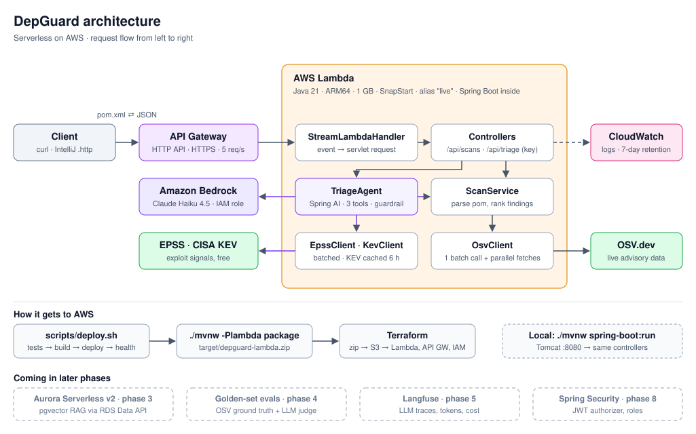

# DepGuard

An AI agent that triages vulnerable Java dependencies using **live, open-source advisory data**.
Give it a `pom.xml`; it tells you which dependencies are dangerous, why, and what to upgrade first.

Built with **Java 21, Spring Boot 3.5** and (from phase 2) **Spring AI**. Each class holds one concept, so the code is easy to read.

> **Status: phase 1 of 8.** A deterministic scan API: no LLM yet. 20 tests pass. Verified
> end to end against the live OSV.dev API. Deploys to AWS serverless (Lambda + SnapStart, about $0 while idle) with `scripts/deploy.sh`;
> removed with `scripts/teardown.sh`.

---

## Architecture

![DepGuard architecture on AWS, drawn with service icons: a developer sends a pom.xml to Amazon API Gateway, which invokes a Java 21 Lambda with SnapStart running Spring Boot. Inside it, StreamLambdaHandler passes the request to ScanController, then ScanService, which uses PomParser and OsvClient; OsvClient calls the OSV.dev API over HTTPS, and logs go to Amazon CloudWatch. Deploying: Maven builds the Lambda zip, Terraform deploys it, a new SnapStart version is published and health-checked. Later phases add Amazon Bedrock, Aurora Serverless v2, Langfuse and Spring Security.](docs/architecture/depguard-architecture-aws.png)

1. **Request:** a client posts a `pom.xml` over HTTPS to **API Gateway**, which throttles it to 5 requests/s and invokes the Lambda's `live` alias.
2. **Inside Lambda:** `StreamLambdaHandler` turns the API Gateway event into a normal servlet request, so the same Spring controller runs
   on Lambda and locally. `ScanService` parses the pom with `PomParser`, asks **OSV.dev** about every dependency through `OsvClient`
   (one batched call, then parallel fetches on virtual threads), and returns the report ranked by severity.
3. **Deploy:** `scripts/deploy.sh` runs the tests, builds `target/depguard-lambda.zip` and applies the Terraform in `infra/serverless/`.
   SnapStart snapshots the started app, so cold starts don't pay the Spring Boot startup cost.
4. **Locally:** `./mvnw spring-boot:run` serves the same controller on Tomcat at port 8080. There is no API Gateway or Lambda handler locally.

The dashed panel shows later phases.

<details>
<summary>Simple box version of the same diagram</summary>



</details>

**Updating the diagrams** (when a phase adds a component):
- Icon version: edit and run `python3 docs/architecture/architecture_diagram_aws.py`. It writes the `.svg` and `.png`
  (the PNG needs `brew install librsvg`). Logos are in `docs/architecture/logos/`; the script's docstring lists where each came from.
- Simple version: edit [depguard-architecture.svg](docs/architecture/depguard-architecture.svg) by hand.

## Phase 1: what works today

```
pom.xml ──► PomParser ──► OsvClient.findVulnerabilityIds ──► OsvClient.getVulnerability (parallel) ──► ScanReport
            (safe XML)     (1 batched HTTP call)              (virtual threads, one per advisory)       (worst first)
```

| Concept | Where |
|---|---|
| REST API with problem-detail errors (RFC 9457) | [api/ScanController.java](src/main/java/dev/depguard/api/ScanController.java), [api/ApiExceptionHandler.java](src/main/java/dev/depguard/api/ApiExceptionHandler.java) |
| Safe parsing of user-uploaded XML (blocks XXE) | [dependency/PomParser.java](src/main/java/dev/depguard/dependency/PomParser.java) |
| Live open data: OSV.dev, free and keyless | [osv/OsvClient.java](src/main/java/dev/depguard/osv/OsvClient.java) |
| Batching: one call for the whole pom | `OsvClient.findVulnerabilityIds` |
| Java 21 virtual threads for parallel I/O | `ScanService.fetchAdvisories`, `spring.threads.virtual.enabled` |
| Explicit timeouts on outbound calls | [osv/OsvConfig.java](src/main/java/dev/depguard/osv/OsvConfig.java), `application.yml` |
| Maven-correct version comparison (`2.9.10.8` < `2.10.0`) | `OsvVulnerability.fixedVersionFor` |
| Honest reports: unresolvable versions are listed as `skipped`, not ignored | `ParsedPom.skipped` |
| Upstream failures return 503 with a safe message; details only in logs | `ApiExceptionHandler` |

## Local demo (free)

Prerequisite: **JDK 21+** (`brew install --cask temurin@21`). Maven comes with the project (`./mvnw`).

```bash
./mvnw test                     # 20 tests, no network needed
./mvnw spring-boot:run          # starts on http://localhost:8080

curl -s -X POST localhost:8080/api/scans \
  -H 'Content-Type: application/xml' \
  --data-binary @samples/vulnerable-pom.xml | jq
```

In IntelliJ: run `DepGuardApplication`, then open [samples/scans.http](samples/scans.http) and click the green arrows.

To run the same container image that goes to AWS: `docker build -t depguard . && docker run -p 8080:8080 depguard`.

Sample output (live data, so the numbers change over time):

```
CRITICAL  log4j-core 2.14.1        -> upgrade 2.25.4  (8 advisories, incl. CVE-2021-44228 Log4Shell)
CRITICAL  spring-web 5.3.20        -> upgrade 6.1.14  (6 advisories)
CRITICAL  jackson-databind 2.9.8   -> upgrade 2.18.11 (60 advisories)
CRITICAL  commons-text 1.9         -> upgrade 1.10.0  (CVE-2022-42889 Text4Shell)
MODERATE  junit 4.12               -> upgrade 4.13.1
skipped:  org.slf4j:slf4j-api (version managed by a parent pom or BOM)
```

Note `spring-web 5 → 6`: a major upgrade that needs Java 17+ and the `javax` → `jakarta` change.
A plain scanner can't explain that; phase 2's agent will.

`docker compose up -d` starts Postgres+pgvector and Redis for later phases (copy `.env.example`
to `.env` first). Phase 1 does not need them.

## Cloud demo on AWS (serverless, about $0 while idle)

DepGuard deploys as a **Lambda function (Java 21, SnapStart) behind an API Gateway HTTP API**.
Nothing runs between requests, so it can stay deployed for weeks at almost no cost.

```bash
scripts/deploy.sh      # run tests, build the Lambda zip, create/update everything, check health (~3-5 min)
scripts/status.sh      # is it deployed? prints the URL and health
scripts/teardown.sh    # delete everything; asks you to type 'destroy' (or pass --yes)
```

Re-running `scripts/deploy.sh` ships a new version: a new Lambda version is published and the `live` alias moves to it.

**Prerequisites:** JDK 21, AWS CLI v2 with credentials (`aws sso login` or `AWS_PROFILE`), Terraform ≥ 1.6.
Docker isn't needed. Optional: `AWS_REGION` (default `us-east-1`).

**What gets created** ([infra/serverless/](infra/serverless/), 10 resources):

```
anyone ──HTTPS──► API Gateway HTTP API ──► Lambda alias "live" ──► Lambda (Java 21, ARM64, 1 GB, SnapStart) ──HTTPS──► api.osv.dev
                  (throttled: 5 req/s,      (newest published         Spring Boot runs inside it unchanged,
                   burst 10)                  version)                  via StreamLambdaHandler
                                                                        logs → CloudWatch (7-day retention)
```

**How Spring Boot runs on Lambda:**
- [StreamLambdaHandler](src/main/java/dev/depguard/lambda/StreamLambdaHandler.java) uses AWS's
  `aws-serverless-java-container` library to turn an API Gateway event into a normal servlet request, so the same
  controllers run locally on Tomcat and on Lambda. [StreamLambdaHandlerTest](src/test/java/dev/depguard/lambda/StreamLambdaHandlerTest.java)
  proves this offline with real-shaped events.
- **SnapStart** boots Spring once when a version is published, snapshots the JVM, and restores the snapshot on cold
  starts. That cuts a multi-second Spring Boot cold start to typically well under a second. It is free for Java.
- `./mvnw -Plambda package` builds `target/depguard-lambda.zip`: classes plus a `lib/` folder of jars. Lambda can't
  run Spring Boot's "jar inside a jar" format, and SnapStart needs a zip rather than a container image.

**Cost** (approximate us-east-1 list prices):

| Situation | ≈ cost |
|---|---|
| Idle | ~$0 (a few cents of log storage at most) |
| One scan (about 2.5 s at 1 GB on ARM64, plus one API request) | ~$0.00003 |
| 1,000 demo scans | ~$0.03, and usually inside Lambda's monthly free allowance |
| Worst case: someone hammers the URL at the 5 req/s throttle all day | ~$15/day. This is why the throttle exists; tear down if you see unexpected traffic. |

**Demo security choices** (fine for a demo; see the next section for production):
- The URL is **public** (HTTPS on the default `execute-api` domain), **throttled** to 5 requests/s with a burst of 10.
  HTTP APIs can't restrict callers by IP; see the production checklist.
- The Lambda role can only write its own logs. Phase 2 adds Bedrock access, and nothing more.
- Terraform state is local (`infra/serverless/terraform.tfstate`, gitignored). **Don't delete it while deployed**;
  teardown needs it to find the resources.

## Design alternatives: taking this to production

The cloud demo is deliberately lean. This section explains what to change for real use, and what each option costs.
Prices are approximate us-east-1 list prices; the UAE (me-central-1) and some other regions are roughly 10–20% higher.

### Options at a glance

| Option | ≈ cost | Good for | Trade-offs |
|---|---|---|---|
| **Serverless (this repo's deploy)**: API Gateway + Lambda SnapStart (+ Aurora Serverless v2 in phase 3) | ~$0 idle (~$1–3/month with Aurora storage) + per request | Demos, spiky or low traffic | Public URL (throttled); first request after Aurora pauses waits ~15 s; Lambda limits |
| **Fargate demo stack** ([infra/fargate/](infra/fargate/), not wired to the scripts) | ~$1.40/day while up | Learning ECS; always-warm demo | Fixed cost while up; HTTP only; public subnets |
| **Lean always-on Fargate** + RDS | ~$60/month (~$2/day) | Small internal tool | Single task: brief downtime when it restarts |
| **Production-grade Fargate** (below) | ~$115+/month (~$3.80/day) before scale | Steady traffic, long requests, streaming | Higher fixed cost, more to operate |

**How to choose:**
- **Serverless** when traffic is low or bursty and cost while idle matters.
- **Fargate** when traffic is steady (it gets cheaper than Lambda at sustained load), when requests run longer than
  30 s (API Gateway's limit; relevant for long agent runs), or when you need long-lived connections such as streaming chat.

LLM usage (from phase 2) is extra and usage-based on either option: about $0.01 per triage question on Claude Haiku
(about 6k tokens in and 1k out), so 1,000 questions cost roughly $10. Check current Bedrock prices.

### Phase 3 note: the database on serverless

A Lambda that joins a VPC to reach a database loses internet access unless you add a NAT Gateway (~$33/month),
and DepGuard needs the internet to call OSV. Two ways to avoid that:
- **Aurora Serverless v2 with the RDS Data API** (recommended): the Lambda stays outside the VPC and runs SQL
  (including pgvector queries) over HTTPS with IAM auth. Aurora can pause at 0 capacity when idle.
- **VPC endpoints** for the AWS services you need, if you need a normal JDBC connection. These cost about $7/month each per AZ.

### Production-grade Fargate stack, always on

| Item | Size | ≈ $/month |
|---|---|---|
| ECS Fargate | 2 tasks across 2 AZs, 0.5 vCPU / 1 GB, ARM64 | 29 |
| Application Load Balancer | with HTTPS listener | 17 |
| NAT Gateway | tasks in private subnets | 33 |
| Public IPv4 | ALB × 2 | 7 |
| RDS Postgres + pgvector | db.t4g.micro, 20 GB (Multi-AZ roughly doubles this) | 14 |
| ElastiCache Redis | cache.t4g.micro (optional, see below) | 12 |
| CloudWatch, Secrets Manager, ECR, Route 53 | | 5 |
| **Total** | | **≈ $115 / month** |

### Checklist: what to change for production (serverless)

| Area | Demo (this repo) | Production |
|---|---|---|
| Entry point | Default `execute-api` URL, public, throttled | Custom domain (Route 53 + ACM). For IP allowlists or AWS WAF, use a REST API or put CloudFront + WAF in front (HTTP APIs support neither) |
| Auth (phase 8) | None in phase 1 | JWT authorizer on API Gateway (Cognito or your IdP) plus Spring Security roles |
| Cold starts | SnapStart | Add SnapStart "priming" (warm up OSV and Jackson classes before the snapshot); provisioned concurrency only if needed |
| Limits | 30 s API Gateway timeout | Long agent runs go async (SQS or Step Functions), or move to Fargate |
| Database (phase 3) | Aurora Serverless v2, min 0 ACU | Min capacity above 0 (no pause), automated backups, Multi-AZ reader |
| Cost protection | Throttle | AWS Budgets alert, per-client usage plans, reserved concurrency as a hard cap |
| Terraform state | Local file | S3 backend with state locking (`use_lockfile = true`), versioning and encryption |
| Deployment | `scripts/deploy.sh` from a laptop | CI/CD (GitHub Actions or Jenkins) assuming an AWS role via OIDC, so no long-lived keys; canary releases by shifting alias weights |
| Monitoring | CloudWatch logs | Alarms on 5xx, latency and throttles; X-Ray tracing; Langfuse for LLM traces (phase 5) |

### Cache: Redis (ElastiCache) or pgvector?

The phase 6 semantic cache answers "have we answered a question like this before?", which is a vector-similarity lookup.
- **pgvector in the existing Postgres:** no extra service or cost, one less thing to operate. Recommended, especially on serverless.
- **ElastiCache (Redis/Valkey):** lower latency at high request rates, and also useful for rate limiting and sessions.
  Adds about $12/month, and a Lambda must join the VPC to reach it (see the phase 3 note).

## Roadmap

| Phase | Adds | Job-skill it demonstrates |
|---|---|---|
| **1** ✅ | Scan API over OSV | Spring Boot Web, Java 21, API design |
| 2 | Spring AI agent with tools: OSV, EPSS, CISA KEV, NVD; prompt templates | Agent tool calling, prompt design |
| 3 | Hybrid RAG over advisories and migration guides (pgvector + full-text + RRF) | RAG, Spring Data |
| 4 | Golden-set evals from OSV ground truth + LLM-as-judge, in CI | Evals design |
| 5 | Langfuse traces: tokens, cost, latency, failures | LLM observability |
| 6 | Semantic cache, prompt caching, model routing | Cost and performance optimization |
| 7 | Model benchmark: quality vs latency vs cost vs risk | Model selection |
| 8 | Spring Security (JWT, roles), human-approved upgrade PRs, production hardening of the AWS stack | Security, guardrails, cloud |

## Data sources

All public. Phase 1 uses only [OSV.dev](https://osv.dev) (aggregates the GitHub Advisory Database, CC-BY 4.0).
Later phases add [FIRST EPSS](https://www.first.org/epss/), [CISA KEV](https://www.cisa.gov/known-exploited-vulnerabilities-catalog)
and the [NVD API](https://nvd.nist.gov/developers).
